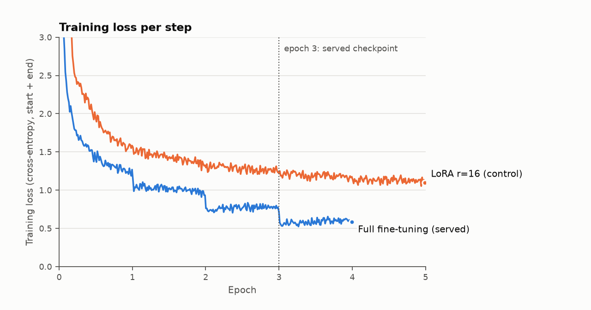
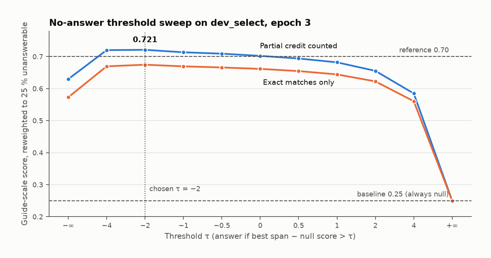

# Project Report — Extractive QA as a Service

## 0. Team

| Field | Value |
|---|---|
| Team id | `Fonchos` |
| Members | Diego Emiliano Romero Castillo, Joshua Gabriel Garcilazo Avendaño, Monica Daniela Alvarenga Mejia, Carlos Eduardo Moreno Diaz, Violeta Natalia Jacobo Bonilla |
| Repository URL | https://github.com/Joshua203-byte/Tareafoncho |
| `submission` commit hash | The commit tagged `submission`, which contains this report (`git rev-parse submission`). |
| Public service URL used at the dry run | Shared with the instructor by message before the dry run (free ngrok fixed domain). |
| AI tools used (which, and for what) | Claude Code (Claude Haiku 5.5 and Sonnet 5.5): training code, API, tests, measurement scripts, plots and this report. Every number comes from our own runs, cited by file. |

## 1. Model choice and justification

- **Base checkpoint:** `distilbert-base-uncased` ([Sanh et al., 2019](https://arxiv.org/abs/1910.01108); 66.4 M parameters, 6 layers, hidden size 768), with no SQuAD fine-tuning (we checked the Hub).
- **Alternatives considered:** `bert-base-uncased` (108.9 M parameters, 235 ms per question on CPU), `roberta-base` (124.1 M, 229 ms), `deberta-v3-base` (183.8 M, 387 ms), `ModernBERT-base` (149.6 M, 317 ms), against 110 ms for DistilBERT (`logs/model_benchmark.json`). With a 5 s timeout and a 150 s cap for 50 items, a 12-layer encoder leaves little margin for a modest quality gain.
- **Trade-off:** a lower quality ceiling for about 40 ms per short question on CPU and a 265 MB model.
- **Adaptation:** full fine-tuning (all 66,364,418 parameters); LoRA (rank 16) was our control and scored 0.697 on the guide-scale score (defined in Section 2) against 0.721 for full fine-tuning.

## 2. Training

| Item | Value |
|---|---|
| Training data | Full SQuAD 2.0 `train`: 130,319 questions (131,754 windows) |
| Validation data | `dev_select`: 5,917 questions of the SQuAD 2.0 `validation` split, divided by article. `dev_report`: the other 5,956, evaluated once. |
| Epochs | 4 trained (2 in `full_ft_2ep`, resumed to 4 in `full_ft_4ep`); epoch 3 selected and served |
| Learning rate and schedule | 3e-5, constant after 6 % warmup |
| Batch size | 32 |
| `max_seq_length` / `doc_stride` | 384 / 128 |
| Hardware and training time | RTX 4050 Laptop (6 GB); 2,358 s + 2,345 s (≈ 78 min) |



- **Where the hyperparameters come from:** the source papers, with no search of our own. Learning rate 3e-5, batch 32 and 2–4 epochs lie in the fine-tuning grid of [BERT](https://arxiv.org/abs/1810.04805) (App. A.3); the 384/128 window is the [Hugging Face QA course](https://huggingface.co/learn/llm-course/chapter7/7) setting; the 6 % warmup is a heuristic (BERT gives none; [LoRA](https://arxiv.org/abs/2106.09685) uses 0.06), and the LoRA control follows its §7.1. The epoch was chosen on validation.
- **Loss curve:** `logs/loss.png` (`scripts/plot_training.py`, from `logs/runs/*/train_log.jsonl`). It drops at each epoch boundary, a sign of memorisation, so we pick the epoch by validation.
- **Validation results:**

| Set | EM | F1 | F1 answerable | Accuracy unanswerable | Guide-scale score |
|---|---|---|---|---|---|
| `dev_select`, epoch 3 (used to choose epoch and τ) | 64.41 | 68.02 | 77.91 | 58.78 | 0.721 |
| `dev_report`, evaluated once (clean) | 62.56 | 66.27 | 74.20 | 57.83 | 0.694 |

**Guide-scale score** is our proxy for the instructor's live grading (guide §XIV.1): 1 for an exact match or a correct `null`, 0.5 for partial overlap (any non-exact answer with token F1 > 0, as we cannot run the LLM judge), 0 otherwise, reweighted to 25 % unanswerable. Always answering `null` gives the 0.25 baseline; the reference is 0.70. It is an estimate, not the final grade.

Epoch 4 has higher EM and F1 but a lower guide-scale score (0.709), so we serve epoch 3 (`logs/dev_select.png`).

## 3. No-answer threshold

- **Decision rule:** the null score is `start[CLS] + end[CLS]` (minimum over windows); the span score is the best valid start/end pair over all windows. We answer with the span if `best span − null > τ`, otherwise `null` ([BERT](https://arxiv.org/abs/1810.04805) §4.3).
- **Choosing τ:** we swept τ on `dev_select`, reweighted to 25 % unanswerable (the hidden-set share; `dev_select` has 48 %). The best is **τ = −2**, on a plateau between −4 and −0.5, and it is the service default (`QA_TAU`).



- **Too low or too high:** τ = −∞ always answers (0.630); τ = +∞ always says `null` (the 0.25 baseline); τ = 4 answers only 34 % of questions (0.585). The threshold alone is worth about 9 points.

## 4. Serving architecture

- **Framework:** FastAPI with uvicorn, **1 worker**.
- **Model loading:** in a background thread; `/health` answers 503 `loading` until ready.
- **Request flow:** token check → JSON and schema validation → 384-token windows with 128 overlap (a 5,000-character context uses several) → one batched CPU forward pass under a lock → τ decides span or `null` → the answer is cut from the original context with character offsets, asserting `context[start:start+len] == answer`.
- **Access control:** `Authorization: Bearer`, compared with `hmac.compare_digest` before the body is read (a bad token is always 401). The token comes from `QA_API_TOKEN`, never from code; the service will not start without it, and `.env` is git-ignored.
- **Tunnel:** ngrok (free fixed domain) as main, Cloudflare Quick Tunnel as backup, via `scripts/tunnel.ps1`; main command `ngrok http 8000`. Both pass the five guide `curl` tests, a smoke test and a robustness battery (`logs/service/`, `docs/fase6_tunel.md`).
- **How to run** from a clean machine:

```bash
pip install -r requirements.txt
# weights are not in git: unzip the GitHub release `weights-v1` in the repo root, then put the token in .env
export QA_API_TOKEN=...                      # PowerShell: $env:QA_API_TOKEN="..."
export QA_MODEL_DIR=models/full_ft_4ep/epoch_3      # default; tokenizer files are in the same folder
uvicorn service.app:app --host 127.0.0.1 --port 8000 --workers 1   # or .\scripts\run.ps1
ngrok http 8000                              # or .\scripts\tunnel.ps1
```

## 5. Results on the public sample set

| Item | Expected | Your answer | `start` | Correct? |
|---|---|---|---|---|
| sample-01 | `16` | `1024 and 16` | 374 | no |
| sample-02 | `3.5 days` | `3.5 days` | 437 | yes |
| sample-03 | `null` | `null` | null | yes |
| sample-04 | `null` | `3` | 310 | no |
| sample-05 | `50,257` | `50,257` | 3157 | yes |

Both errors are the model's, not the service's: the same model run outside the service, one window at a time without padding, gives identical answers on these five items and on 1,000 `dev_select` questions (`logs/service/eval_service_sample.txt`). In sample-01 it starts the span at "1024" (start logit 7.16) instead of "16" (6.01), a margin of 6.2 over the null score that no reasonable τ changes. sample-04 is a near miss (the context gives "3 times" for GPT-3, the question asks about BERT-base) and tuning τ for one item would overfit.

## 6. Model size and latency (not graded)

| Item | Value |
|---|---|
| Parameters | 66,364,418 |
| Size on disk | 265 MB (`model.safetensors`, fp32) |
| Mean latency per `/predict` request on our laptop (CPU) | 37–41 ms for ≈ 450-character contexts; 330 ms for the 3,171-character context (3 windows) (`logs/service/bench_predict.txt`). Over 1,000 `dev_select` questions: mean 71 ms, p95 112 ms. |
| Through the tunnel (50 sequential requests) | ngrok 13.6 s, Cloudflare 13.9 s, slowest 608 ms; local 5.9 s. The tunnel adds about 150 ms per request. |
| Laptop CPU and RAM | Intel Core i7-12650H (10 cores, 16 threads), 16 GB RAM |

## 7. Problems encountered and how you fixed them

1. **Problem:** early stopping at τ = 0 picked a bad epoch (answerable F1 swung between 53 and 70). **Cause:** τ = 0 moves every epoch, so the metric tracked the threshold. **Fix:** select by the guide-scale score with τ swept per epoch. **Commit:** `9fb7163`, `909035a`.
2. **Problem:** a confident `null` got `score` 0.0056 (the contract needs [0, 1]). **Cause:** `predict_example` mixed a margin for spans with the raw null logit. **Fix:** a sigmoid of the distance to τ. **Commit:** `498992e`, `c05d43c`.
3. **Problem:** real-model tests were skipped silently without weights. **Cause:** weights are not in git. **Fix:** a visible skip reason, `QA_MODEL_DIR` and a service-versus-reference test. **Commit:** `0a391e2`, `832b405`.
4. **Problem:** ngrok refused the agent installed by winget (`ERR_NGROK_121`). **Cause:** 3.3.1 is below the 3.28.0 minimum. **Fix:** install from the Microsoft Store (3.39.11). **Commit:** `53db785`.

## 8. Decoder investigation

A decoder-only model (GPT-1: 117 M parameters, 512-token context; [Radford et al., 2018](https://cdn.openai.com/research-covers/language-unsupervised/language_understanding_paper.pdf)) or an encoder–decoder (e.g. T5, [Raffel et al., 2020](https://arxiv.org/abs/1910.10683)) generates the answer as text instead of picking a span. We relate it to three problems measured on our model; the costs are orders of magnitude, not measurements.

**1. Near-miss unanswerable questions (sample-04; 57.8 % accuracy on unanswerable questions in `dev_report`, our weakest result).** SQuAD 2.0 unanswerable questions are written to resemble answerable ones ([Rajpurkar et al., 2018](https://arxiv.org/abs/1806.03822)). We compare two scalar scores at `[CLS]`; a generative model reads the whole question and could output "unanswerable". *Cost:* 1.8× (GPT-1) to 3.3× (T5-base, 220 M) the parameters; larger models cannot be fully fine-tuned in 6 GB of VRAM, so LoRA would be needed, and it lost 2.4 points in our control; and we would lose τ (worth 9 points) and have to rebuild it from sequence probabilities.

**2. A wrong span boundary (sample-01, "1024 and 16").** Start and end come from independent logits, so an incoherent pair can win; a decoder conditions each token on the previous ones. *Cost:* the contract needs `context[start:start+len] == answer`, but generation can paraphrase ("16 heads"), so we need constrained decoding or a fallback to `null`, and `start` needs a text search that is ambiguous for repeated strings.

**3. Long contexts (3 windows: 330 ms against about 40 ms for one).** Windows need a merge rule; a longer-context decoder reads the paragraph once. *Cost:* GPT-1's 512 tokens cannot hold sample-05 (665 tokens), and GPT-2's 1,024 ([Radford et al., 2019](https://cdn.openai.com/better-language-models/language_models_are_unsupervised_multitask_learners.pdf)) is borderline for 5,000 characters. Per token the compute is about 2× ours plus a pass per generated token: about 0.5 s for a short answer, but long-context models have billions of parameters, against a 5 s limit on a laptop CPU.

References: [Radford et al. (2018)](https://cdn.openai.com/research-covers/language-unsupervised/language_understanding_paper.pdf), GPT-1; [Radford et al. (2019)](https://cdn.openai.com/better-language-models/language_models_are_unsupervised_multitask_learners.pdf), GPT-2; [Raffel et al. (2020)](https://arxiv.org/abs/1910.10683), T5; [Rajpurkar et al. (2018)](https://arxiv.org/abs/1806.03822), SQuAD 2.0; [Devlin et al. (2019)](https://arxiv.org/abs/1810.04805), BERT §4.3 and A.3; [Hu et al. (2021)](https://arxiv.org/abs/2106.09685), LoRA §7.1; [Sanh et al. (2019)](https://arxiv.org/abs/1910.01108), DistilBERT.

## 9. Known limitations

- **Wrong answers:** sample-01 and sample-04 (Section 5), both model errors; a 50-question score varies by about ±0.06 by chance.
- **Distribution shift:** τ and all scores come from SQuAD-style text; the hidden set uses other texts, so its share of `null` answers and its score may differ.
- **Score:** the `score` field is not a calibrated probability, and it changes if τ changes.
- **Concurrency, input, auth:** one worker and one lock, so simultaneous requests queue; English only; one shared token, no rotation or rate limit.
- **Availability:** the service needs this laptop on, plugged in and online with the tunnel running; the backup tunnel was tested from the same laptop only.
